# QFLUX · A 股研究数据平台

从沪深北行情采集、历史补录到 DuckDB 研究仓库。原始价长期保留，增量数据按主键合并，任务可以中断恢复，历史修订和来源有记录。

## 阅读导航

- [开始使用](#开始使用)：安装、启动和建立数据。
- [项目目录与文件职责](#项目目录与文件职责)：逐文件寻找入口、业务代码和工具。
- [后端结构与阅读入口](#后端结构与阅读入口)：职责边界、接口与实现。
- [程序设计与交互流程](#程序设计与交互流程)：启动、任务、分页、恢复、事务和预览设计图。
- [数据约定与边界](#数据约定与边界)：时间、单位、来源及完整性。
- [验证](#验证)：测试、构建和浏览器回归命令。

## 开始使用

需要 Go 1.24+、Node.js 20+ 和 C/C++ 编译器。DuckDB 由 Go 通过 GORM 操作，底层使用官方 `database/sql` 驱动，编译时启用 CGO；只有使用 BaoStock 数据源时才需要 Python 3.13（已验证版本）。在本目录执行：

```powershell
npm run setup:native
npm run frontend:install
# 可选：使用 BaoStock 时安装 SDK；通达信、本地导入和 DuckDB 均无需 Python
npm run setup:data
npm run dev
```

打开 <http://127.0.0.1:7100>。默认 CSV 在 `downloads/`，数据库在 `data/quotes.duckdb`，任务日志在 `data/jobs/`。`setup:data` 仅安装到项目 `.venv`，不修改系统 Python。

`setup:native` 优先复用已有编译器；Windows x64 缺少 GCC 时下载固定版本并核验 SHA-256，安装在忽略提交的 `.tools/`。Linux 安装 `build-essential`，macOS 安装 Xcode Command Line Tools。`scripts/go.mjs` 只为当前构建启用 CGO 并选择编译器，不修改系统 PATH 或全局 Go 设置。Windows 产物静态链接 DuckDB 和 GCC 运行库，运行时无需编译器、Python DuckDB 包或额外 DuckDB DLL。

驱动固定为 `github.com/duckdb/duckdb-go/v2 v2.5.4`，内嵌 DuckDB 1.4.3，与既有数据库保持一致。GORM 固定为 `v1.31.2`，负责模型映射、建表、批量 upsert、查询构建和整批事务；迁移按显式版本只创建缺失表和视图，十进制解析、质量检查、修订合并与 Parquet 导出集中在 Go Repository。DuckDB 方言使用 GORM 原生回调，保留复合主键及冲突更新语义，不额外引入另一套数据库驱动。

建议依次建立数据：

1. 选择 **BaoStock、沪深、日线、历史建库、DuckDB**，采集来源提供的历史证券（包括退市证券），同时同步上市/退市资料、交易日历和独立复权因子。
2. 选择 **通达信、北京、日线** 补充北交所。通达信还支持 1 分钟；在线站仅提供其保留的近期记录，不能承诺三年分钟历史。多年 1 分钟数据需在「数据仓库」补录 `.lc1` / 分钟 CSV，再持续增量维护。
3. 此后使用 **增量维护**。系统保留旧历史，并回看最近 7 个自然日，更新近期记录。
4. 在 **数据仓库** 查看实际覆盖范围、查询数据集、补录历史文件或导出 Parquet 研究快照。

上述步骤是数据构建流程，不代表免费源已证明覆盖所有历史 A 股。退市遗漏、代码迁移、停牌信息和分钟历史边界仍需要核验；详见 [数据约定与边界](#数据约定与边界)。

## 主要能力

| 能力 | 行为 |
| --- | --- |
| A 股范围 | 按交易所筛选 A 股代码，排除指数、ETF、债券、B 股及北交所 889 申购代码 |
| 多数据源 | 通达信并发采集；BaoStock 官方 SDK 顺序采集；本地 `.day/.lc1/.lc5/CSV` 补录 |
| 行情线路 | 内置主备站 TCP 连通性检测，按耗时选线；悬停或点击顶部“服务已连接”查看名称、IP 和最近检测结果 |
| 日期范围 | 包含起止当天，按北京时间解释；通达信自动分页、排序、去重 |
| 增量更新 | 合并旧历史，重叠记录以新数据为准，失败不写空文件 |
| DuckDB | 主键幂等入库，价格/成交额使用 Decimal，成交量统一为股 |
| 审计 | 来源、请求范围、文件哈希、入库回执、旧行情修订和 schema 版本 |
| 恢复 | 持久证券计划和逐文件断点；验证原始文件及因子附件哈希后复用 |
| 参考数据 | 上市/退市名录、交易日历、独立因子表；缺口只作为候选提示 |
| 研究导出 | 同一事务中的行情、名录、日历、因子、回执、修订 Parquet 快照及 manifest |

## 无界面运行与计划任务

```powershell
npm run backend:build

# 沪深历史建库，含来源提供的退市证券、日历、独立因子
.\bin\quotes.exe --sync --source baostock --full --from 1990-12-19

# 默认沪深北通达信增量日线；结束日默认北京时间昨日
.\bin\quotes.exe --sync

# 单只证券与周期
.\bin\quotes.exe --sync --source baostock --codes sh600000 --from 2020-01-01
.\bin\quotes.exe --sync --category 7 --codes sh600000 --from 2026-10-01

# 恢复任务原有计划，已经验证的文件不重复下载
.\bin\quotes.exe --resume <任务编号>
```

Linux/macOS 可以通过 `node scripts/go.mjs run --sync ...` 使用相同参数。批处理可交给系统计划任务调用；GUI 服务持有同一数据目录时，使用其 REST API 启动任务，或先关闭 GUI 服务。操作系统锁会拒绝第二个写者，并在进程退出或崩溃后自动释放。

`--data-dir` / `QFLUX_DATA_DIR` 设置数据库和日志目录；`--output` / `QUOTES_OUTPUT` 设置归档目录；`QFLUX_PYTHON` 仅为 BaoStock SDK 指定现有 Python 环境。出站代理可用 `--proxy` 指定，或按 `ALL_PROXY` → `HTTPS_PROXY` → `HTTP_PROXY` 环境变量读取初始值，也可在网页高级设置中配置并持久保存。完整参数见 `bin/quotes.exe --help`。

## 在自己的研究代码中读取

DuckDB 数据文件由应用进程单写。应用运行时推荐导出 Parquet 快照，在研究进程中读取；应用关闭后可直接只读打开数据库。

Python 研究示例为可选客户端，单独安装其依赖；它不参与后端入库。也可在自己的 Go 程序中使用相同 DuckDB 驱动。

```powershell
.venv\Scripts\python.exe -m pip install duckdb==1.4.3
.venv\Scripts\python.exe scripts/research.py --database data/quotes.duckdb --symbol sh600000
.venv\Scripts\python.exe scripts/research.py --snapshot data/exports/snapshot-... --symbol sh600000
```

完整示例在 [scripts/research.py](scripts/research.py)。Parquet 快照也便于后续迁移 ClickHouse；本版本的数据库实现是 DuckDB，存储端口已独立，详见 [架构说明](#后端结构与阅读入口)。

## 项目目录与文件职责

以下以当前 Git 根目录 `src/` 为基准，每个文件后的注释说明其角色。测试紧邻实现，`original/` 只作历史参考。`cmd` 是入口组织约定，`internal` 是 Go 的导入可见性边界，两者并非两个业务层。

### 入口、配置与协作

```text
src/
├── .github/
│   └── workflows/
│       └── ci.yml  # 持续集成：安装、测试、静态检查和构建
├── cmd/
│   └── qflux/
│       ├── main.go  # 启动入口：参数、依赖注入、代理、锁与资源关闭
│       └── sync.go  # 无界面采集/恢复与终态等待
├── .gitignore  # 忽略数据、工具和构建产物
├── AGENTS.md  # 协作约定、架构边界与验证要求
├── Makefile  # 常用命令的 Make 别名
├── README.md  # 项目使用、文件导航和设计说明
├── go.mod  # Go 模块与依赖版本
├── go.sum  # Go 依赖内容校验和
├── package.json  # 统一安装、运行、验证及构建命令
└── requirements-data.txt  # 可选 BaoStock SDK 的 Python 依赖
```

### 后端实现与测试

```text
src/
└── internal/
    ├── domain/
    │   ├── adjustment.go  # 纯前复权/后复权算法
    │   ├── archive.go  # 采集批次、归档回执、本地输入和哈希状态
    │   ├── files.go  # 目录条目、路径及浏览结果模型
    │   ├── job.go  # 任务快照、文件结果、计划、事件与断点实体
    │   ├── job_options.go  # 下载选项默认值、证券代码及日期约束
    │   ├── job_options_test.go  # 测试：选项、代码和日期约束
    │   ├── line.go  # 线路自检状态与报告
    │   ├── market.go  # 证券、K 线、交易日、因子、市场时区和周期名称
    │   ├── preview.go  # 预览输入约束与响应模型
    │   ├── proxy.go  # 代理地址解析、规范化与设置模型
    │   ├── proxy_test.go  # 测试：代理地址及接口约束
    │   ├── universe.go  # A 股市场和证券代码范围判断
    │   ├── universe_test.go  # 测试：A 股代码范围
    │   ├── validation.go  # 时间、有限数值及 OHLC 关系校验
    │   ├── warehouse.go  # 仓库查询约束、游标及研究响应模型
    │   └── warehouse_test.go  # 测试：研究查询日期、证券、周期与分页参数约束
    ├── handler/
    │   ├── defaults_test.go  # 测试：默认选项与接口契约
    │   ├── files.go  # 目录浏览与创建接口
    │   ├── preview.go  # CSV 预览参数解析与响应
    │   ├── preview_test.go  # 测试：CSV 预览参数解析与响应回归
    │   ├── proxy.go  # 代理设置 HTTP 接口
    │   ├── proxy_test.go  # 测试：代理地址及接口约束
    │   ├── server.go  # Echo 路由、中间件、任务接口、SSE 与错误映射
    │   ├── test_helpers_test.go  # 测试：依赖组装和公共辅助
    │   ├── warehouse.go  # 仓库查询、参考导入、导出与模板接口
    │   └── workspace_test.go  # 测试：目录与工作区接口
    ├── platform/
    │   ├── baostock/
    │   │   ├── source.go  # Go 历史源适配、能力注册及 SDK 会话管理
    │   │   └── source_worker.py  # 官方 BaoStock Python SDK 工作进程
    │   ├── bridge/
    │   │   ├── jsonlines.go  # JSON Lines 进程通信、超时与取消
    │   │   └── jsonlines_test.go  # 测试：JSON Lines 进程通信、超时与取消回归
    │   ├── filesys/
    │   │   ├── browser.go  # 本机目录浏览和创建
    │   │   └── browser_test.go  # 测试：本机目录浏览和创建回归
    │   ├── frontend/
    │   │   └── runner.go  # 定位前端、准备依赖及管理 Vite 生命周期
    │   ├── historyfile/
    │   │   ├── source.go  # 本地扫描及 .day/.lc1/.lc5/CSV 格式注册与解码
    │   │   └── source_test.go  # 测试：来源扫描、解码与数据保护
    │   ├── lines/
    │   │   ├── provider.go  # 内置配置、去重与TCP 连通性探测
    │   │   └── provider_test.go  # 测试：内置配置、去重与TCP 连通性探测回归
    │   ├── netdial/
    │   │   ├── dialer.go  # 统一直连、SOCKS、CONNECT 与出站 HTTP 传输
    │   │   └── dialer_test.go  # 测试：统一直连、SOCKS、CONNECT 与出站 HTTP 传输回归
    │   ├── processlock/
    │   │   ├── lock_test.go  # 测试：跨进程互斥与释放
    │   │   ├── lock_unix.go  # Unix 数据目录单写者锁
    │   │   └── lock_windows.go  # Windows 数据目录单写者锁
    │   ├── sitecfg/
    │   │   ├── testdata/
    │   │   │   └── connect.cfg  # 原始 Python 配置的黄金对照样本
    │   │   ├── build.go  # 构建和保存 GBK/CRLF 配置
    │   │   ├── parse.go  # 回读并校验配置分区、站点与引用
    │   │   ├── sitecfg_test.go  # 测试：配置生成、校验和黄金对照
    │   │   ├── spec.go  # 配置规格与校验模型
    │   │   ├── template.go  # 有序模板及键值序列化
    │   │   └── template_data.go  # 内置原始配置模板数据
    │   └── tdx/
    │       ├── client.go  # 通达信连接、请求、重试与换线
    │       ├── client_test.go  # 测试：通达信连接、请求、重试与换线回归
    │       └── decode.go  # 协议报文、时间及价格解码
    ├── repository/
    │   ├── archive_csv.go  # CSV 校验、历史合并与临时文件发布
    │   ├── archive_csv_test.go  # 测试：CSV 校验、历史合并与临时文件发布回归
    │   ├── archive_state.go  # 归档/因子哈希、状态附件和断点验证
    │   ├── duckdb.go  # 原生连接、GORM 方言、事务与延迟初始化/关闭
    │   ├── factors.go  # gbbq 解码、独立因子附件及行情 CSV 读取
    │   ├── factors_test.go  # 测试：gbbq 解码、独立因子附件及行情 CSV 读取回归
    │   ├── jobs_jsonl.go  # JSONL 事件同步写入、计划和日志重放
    │   ├── preview.go  # 预览用的只读归档端口实现
    │   ├── settings.go  # 代理 JSON 设置加载与原子保存
    │   ├── warehouse_read.go  # 统计、数据集/行情查询、缺口候选和 Parquet 快照
    │   ├── warehouse_schema.go  # 持久化模型、主键、精度及显式版本迁移
    │   ├── warehouse_test.go  # 测试：仓库精度、事务、质量、修订、查询和导出
    │   └── warehouse_write.go  # 十进制解析、质量检查、修订及批量 upsert
    ├── service/
    │   ├── downloader_test.go  # 测试：重试、取消和调度
    │   ├── history.go  # 历史分页、日期过滤、去重及边界停止
    │   ├── history_test.go  # 测试：分页、重复页及日期边界
    │   ├── ingestion_test.go  # 测试：多来源采集与统一保存
    │   ├── integration_test.go  # 测试：采集生命周期集成
    │   ├── job_run.go  # 任务运行状态、进度快照、日志及终态记录
    │   ├── jobs.go  # 活动任务互斥、选项检查与任务创建
    │   ├── local.go  # 本地输入计划、逐文件解码与失败隔离
    │   ├── models.go  # Domain 类型别名，避免复制实体
    │   ├── names.go  # 领域命名委托及归档路径组合
    │   ├── persistence_test.go  # 测试：断点、重启和恢复
    │   ├── ports.go  # 采集、归档、因子、日志及仓库消费端接口
    │   ├── preview.go  # 完整历史读取、复权编排及输出窗口
    │   ├── preview_test.go  # 测试：完整历史读取、复权编排及输出窗口回归
    │   ├── protocol_test_helpers_test.go  # 测试：测试协议服务辅助
    │   ├── recovery.go  # 日志恢复、离线恢复捷径和退出等待
    │   ├── remote.go  # 历史源注册、名录/日历同步和顺序采集
    │   ├── settings.go  # 代理设置校验、保存与当前值发布
    │   ├── settings_test.go  # 测试：代理保存与生效
    │   ├── tdx_ingestion.go  # 执行路径分派、通达信准备、计划持久化与 worker 调度
    │   ├── test_helpers_test.go  # 测试：依赖组装和公共辅助
    │   ├── warehouse.go  # 类型化研究查询与导入/导出编排
    │   ├── worker.go  # 单证券采集、保存顺序、成功断点与恢复重放
    │   ├── worker_test.go  # 千证券并发屏障、worker 上限与单连接独占测试
    │   └── workspace.go  # 目录能力与线路测试用例
    └── architecture_test.go  # 检查生产 import，防止架构越界
```

### 前端实现与基础组件

```text
src/
└── frontend/
    ├── src/
    │   ├── components/
    │   │   ├── ui/
    │   │   │   ├── accordion.tsx  # UI 基础组件：折叠面板
    │   │   │   ├── alert-dialog.tsx  # UI 基础组件：确认对话框
    │   │   │   ├── alert.tsx  # UI 基础组件：提示消息
    │   │   │   ├── aspect-ratio.tsx  # UI 基础组件：固定宽高比容器
    │   │   │   ├── avatar.tsx  # UI 基础组件：头像
    │   │   │   ├── badge.tsx  # UI 基础组件：状态标签
    │   │   │   ├── breadcrumb.tsx  # UI 基础组件：面包屑
    │   │   │   ├── button-group.tsx  # UI 基础组件：按钮组
    │   │   │   ├── button.tsx  # UI 基础组件：按钮
    │   │   │   ├── calendar.tsx  # UI 基础组件：日历
    │   │   │   ├── card.tsx  # UI 基础组件：卡片
    │   │   │   ├── carousel.tsx  # UI 基础组件：轮播
    │   │   │   ├── chart.tsx  # UI 基础组件：图表样式与提示封装
    │   │   │   ├── checkbox.tsx  # UI 基础组件：复选框
    │   │   │   ├── collapsible.tsx  # UI 基础组件：可折叠区域
    │   │   │   ├── command.tsx  # UI 基础组件：命令搜索
    │   │   │   ├── context-menu.tsx  # UI 基础组件：右键菜单
    │   │   │   ├── dialog.tsx  # UI 基础组件：模态对话框
    │   │   │   ├── drawer.tsx  # UI 基础组件：抽屉
    │   │   │   ├── dropdown-menu.tsx  # UI 基础组件：下拉菜单
    │   │   │   ├── empty.tsx  # UI 基础组件：空状态
    │   │   │   ├── field.tsx  # UI 基础组件：字段布局
    │   │   │   ├── form.tsx  # UI 基础组件：表单上下文
    │   │   │   ├── hover-card.tsx  # UI 基础组件：悬浮详情
    │   │   │   ├── input-group.tsx  # UI 基础组件：输入框组合
    │   │   │   ├── input-otp.tsx  # UI 基础组件：验证码输入
    │   │   │   ├── input.tsx  # UI 基础组件：文本输入
    │   │   │   ├── item.tsx  # UI 基础组件：列表项
    │   │   │   ├── kbd.tsx  # UI 基础组件：键盘提示
    │   │   │   ├── label.tsx  # UI 基础组件：标签
    │   │   │   ├── menubar.tsx  # UI 基础组件：菜单栏
    │   │   │   ├── navigation-menu.tsx  # UI 基础组件：导航菜单
    │   │   │   ├── pagination.tsx  # UI 基础组件：分页
    │   │   │   ├── popover.tsx  # UI 基础组件：浮层
    │   │   │   ├── progress.tsx  # UI 基础组件：进度条
    │   │   │   ├── radio-group.tsx  # UI 基础组件：单选组
    │   │   │   ├── resizable.tsx  # UI 基础组件：尺寸可调面板
    │   │   │   ├── scroll-area.tsx  # UI 基础组件：滚动区域
    │   │   │   ├── select.tsx  # UI 基础组件：下拉选择
    │   │   │   ├── separator.tsx  # UI 基础组件：分隔线
    │   │   │   ├── sheet.tsx  # UI 基础组件：侧边面板
    │   │   │   ├── sidebar.tsx  # UI 基础组件：侧栏
    │   │   │   ├── skeleton.tsx  # UI 基础组件：加载骨架
    │   │   │   ├── slider.tsx  # UI 基础组件：范围滑块
    │   │   │   ├── sonner.tsx  # UI 基础组件：全局通知
    │   │   │   ├── spinner.tsx  # UI 基础组件：加载指示器
    │   │   │   ├── switch.tsx  # UI 基础组件：开关
    │   │   │   ├── table.tsx  # UI 基础组件：表格
    │   │   │   ├── tabs.tsx  # UI 基础组件：标签页
    │   │   │   ├── textarea.tsx  # UI 基础组件：多行输入
    │   │   │   ├── toggle-group.tsx  # UI 基础组件：切换按钮组
    │   │   │   ├── toggle.tsx  # UI 基础组件：切换按钮
    │   │   │   └── tooltip.tsx  # UI 基础组件：悬浮提示
    │   │   ├── DataLibrary.tsx  # 仓库总览、检索、补录、恢复和导出
    │   │   ├── DownloadForm.tsx  # 数据源、市场、日期、存储和高级配置表单
    │   │   ├── PathBrowser.tsx  # 网页内目录/因子选择及新建目录
    │   │   ├── PricePreview.tsx  # 完整历史、日期范围、框选、概览与明细翻页
    │   │   └── TaskMonitor.tsx  # 任务进度、状态、日志和文件结果
    │   ├── hooks/
    │   │   ├── use-mobile.ts  # 移动端媒体查询状态
    │   │   └── useTask.ts  # SSE 快照订阅与连接状态
    │   ├── lib/
    │   │   ├── api.ts  # 集中 API 调用、取消信号和历史游标加载
    │   │   ├── dates.ts  # 下载表单日期处理工具
    │   │   ├── preview.ts  # 日期二分定位与保留极值的图表采样
    │   │   └── utils.ts  # 合并 className 等 UI 工具
    │   ├── types/
    │   │   └── index.ts  # 请求/响应及前后端共享语义类型
    │   ├── App.tsx  # 应用布局、采集/仓库切换与共享状态
    │   ├── index.css  # 暗色主题、控件、布局和响应式样式
    │   └── main.tsx  # 挂载 React 根节点与全局样式
    ├── .gitignore  # 前端生成文件忽略规则
    ├── README.md  # 前端脚手架说明
    ├── components.json  # shadcn 组件生成与别名配置
    ├── eslint.config.js  # TypeScript / React Hooks 检查规则
    ├── index.html  # Vite HTML 入口
    ├── info.md  # UI 脚手架初始化记录，非运行配置
    ├── package-lock.json  # 锁定前端依赖，保证重复安装
    ├── package.json  # 前端依赖、开发、检查和构建命令
    ├── postcss.config.js  # PostCSS 与 Tailwind 插件
    ├── tailwind.config.js  # 主题、源码扫描范围和样式插件
    ├── tsconfig.app.json  # 浏览器业务代码的类型检查配置
    ├── tsconfig.json  # TypeScript 工程引用入口
    ├── tsconfig.node.json  # Node 工具代码的类型检查配置
    └── vite.config.ts  # Vite、端口、API 代理与构建分包
```

### 工具、测试与历史参考

```text
src/
├── original/
│   ├── connect.cfg  # 原始线路配置
│   ├── dash.html  # 原始看板页面
│   ├── spec.json  # 原始工具配置规格
│   ├── tdx_adjust.py  # 原始复权算法参考
│   ├── tdx_bootstrap.py  # 原始配置生成与工具启动参考
│   ├── tdx_client.py  # 原始 Python 协议客户端参考
│   ├── tdx_dash.py  # 原始看板服务
│   ├── tdx_factors.py  # 原始因子读取参考
│   ├── tdx_local.py  # 原始本地行情文件读取参考
│   └── tdx_realtime.py  # 原始实时行情采集脚本
├── scripts/
│   ├── browser_smoke.mjs  # 表单、主题、预览及可选真实采集浏览器回归
│   ├── go.mjs  # Go 启动器：设置 CGO 和项目本地编译器
│   ├── native-env.mjs  # 探测原生工具链并构造编译环境
│   ├── preview.test.mjs  # 日期边界、概览采样和原始序列保留测试
│   ├── research.py  # 可选只读 DuckDB / Parquet 研究客户端
│   ├── setup-data.mjs  # 准备可选 Python 环境和 BaoStock 依赖
│   ├── setup-native.mjs  # 下载/复用编译器及完整性校验
│   ├── smoke_preview.py  # 组织临时服务、Chrome 与清理流程
│   └── test-data.mjs  # 运行原生仓库及 SDK 保护测试
└── tests/
    └── test_source_guard.py  # BaoStock SDK 返回结果与来源保护测试
```

### 本地产物目录

这些目录由安装、运行或验证生成，不作为源文件提交：

```text
src/
├── .tools/           # 项目本地编译器
├── .venv/            # 可选 BaoStock / 研究 Python 环境
├── node_modules/     # 本机 Node 工具依赖（如有）
├── frontend/
│   ├── node_modules/ # 前端依赖
│   └── dist/         # 前端生产构建
├── bin/              # Go 可执行文件
├── artifacts/        # 冒烟日志、截图及临时测试数据
├── downloads/        # 原始 CSV、独立因子与归档状态附件
└── data/             # DuckDB、任务日志、设置、进程锁及 exports
```

推荐顺序：`cmd/qflux/main.go` → `internal/handler/server.go` → `internal/service/jobs.go` / `ports.go` → 对应 Domain 实体 → 用例与 Repository / Platform 实现。`ui/` 是通用组件库，不表示每个组件都已被业务页面使用。

## 后端代码导航

后端按 `handler → service → domain` 组织，存储实现集中在 `repository`，协议、SDK 和进程能力集中在 `platform`。依赖由 `cmd/qflux` 组装，Service 不导入具体存储或平台实现。目录、调用流程及每类修改的阅读入口见 [后端结构](#后端结构与阅读入口)，分层边界由自动测试约束。

## 工具脚本

`scripts/` 统一存放构建与安装工具（`go.mjs`、`setup-*.mjs`）、自动验证（`test-data.mjs`、`preview.test.mjs`、`smoke_preview.py`、`browser_smoke.mjs`）和可选研究示例（`research.py`）。研究示例仅作为读取数据的客户端，不参与后端运行。

## 下载并发与流量控制

通达信采集使用有界 worker 池，并行处理不同证券。默认 32 个 worker，可在高级设置改为 1–64；实际启动数不超过本次证券数，每个 worker 独占一个 TCP 客户端并复用连接。该默认值针对网络等待而非 CPU 计算调优，无需按 CPU 核数缩放；实测 32 与 40 worker 吞吐相当，继续增加并发反而会受慢线路和服务端响应制约。单个 worker 内保持串行收发，避免通达信同步协议的应答错位，不为每只证券无限创建协程。队列容量为实际 worker 数的两倍，生产者会等待，取消后停止投递并等待 worker 收尾。

大任务先以同一只证券的同一页真实行情测量候选线路，优选最多 8 条作为 worker 初始线路；凑齐 8 条成功响应即结束测速。客户端保留完整候选列表及测速后的优先级，失败时仍按顺序轮换，不保证每台负载完全一致，也不能保证服务商不会限流或拒绝连接。

任务启动前的 TCP 线路初筛与下载客户端共用 `golang.org/x/time/rate` 提供的全局限流器，默认 40 次/秒、突发为 1。初筛每站只建立并关闭一次 TCP 连接，不发送行情握手或业务数据；下载阶段仅在拨号前和复用连接发送业务请求前等待。握手及新连接首包连续完成，避免协议初始化后的空闲等待导致服务端断线。限流等待可取消，失败重试仍采用指数退避与随机抖动。这里控制的是操作启动频率，不是下载字节带宽；默认值是本项目的保护配置，不是行情服务器公布的容量。

手动“重新检测”会先执行上述 TCP 初筛，再为每个初筛通过的站点建立独立新连接，发送轻量证券数量请求并等待完整响应。页面显示的“往返耗时”覆盖拨号、通达信握手、请求写入、响应读取与解码；TCP 成功但行情握手或请求失败的线路会显示失败，初筛失败项也不会从列表中隐藏。大任务开始前的自动选线仍使用同一页 K 线，以测量更贴近实际下载的响应性能。

高级设置中的“全局请求频率”随任务保存，启动探测前应用，允许 1–200 次/秒；旧任务未配置时采用默认值。默认单连接超时 8 秒、单页 800 条、失败重试 3 次。提高并发主要用于重叠网络等待，实际吞吐仍受行情源、网络、分页与单连接 DuckDB 入库制约，不应仅把所有上限调到最大。

```powershell
# 无界面批处理同样支持并发和全局限速配置
.\bin\quotes.exe --sync --workers 32 --request-rate 40
```

BaoStock 仍采用单个 SDK 顺序会话，上述并发与流量控制针对通达信路径；本地导入不受网络频率限制。

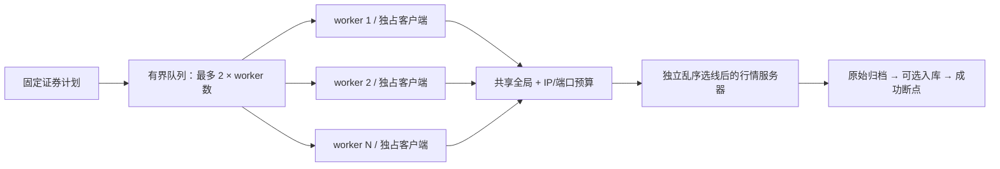

## 可用行情站点

顶部“服务已连接”状态元素支持鼠标悬停、点击以及键盘 Enter / Escape。下载前的自动 TCP 连通性检测结果随任务快照展示，也可点击“重新检测”（高级设置中的检测按钮同样有效）。列表按站点单行展示状态、名称、完整 IP/端口和TCP 建连耗时，失败站点也直接展示；手机可在浮层内横向滚动，支持 IPv6 和键盘操作。

名称来自内置配置的 HostName，地址仍按 IP 与端口去重；主备重复地址优先保留主站名称。列表标注最近检测时间，表示当次 TCP 连接结果，不保证行情业务请求成功，不表示持续在线，也不表示某条线路正被哪个 worker 使用。悬停本身不会触发网络请求，历史任务可保留其当时的检测报告；旧报告没有 TCP 类型标记时，界面仍按历史检测口径展示耗时。

## 行情预览

预览默认浏览当前文件或仓库数据集的完整已存历史，不再限于最近 800/1,000 条。输入起止日期后点击“应用日期”（包含结束日），或在曲线上拖动框选放大；下方完整历史概览可拖动两端手柄或平移选区，“查看全部”恢复完整范围。明细随范围变化，每页 100 条，使用“最新 / 最早”和翻页按钮查看每条记录。

大量记录使用保留收盘价极值的概览绘制，放大后显示细节，明细数据不采样。仓库按时间游标分批读取，关闭预览会取消尚未完成的加载；“完整”指实际已存记录，不代表行情来源覆盖了全部上市历史。

## 验证

```powershell
npm test
npm run test:preview
node scripts/go.mjs vet ./...
npm run test:data
npm run frontend:lint
npm run build
python scripts/smoke_preview.py

# 额外验证真实通达信采集、DuckDB 入库与预览
$env:QFLUX_SMOKE_DOWNLOAD = '1'
python scripts/smoke_preview.py
```

`npm test` 包含真实 DuckDB 引擎测试，无需 Python DuckDB；`test:data` 额外运行 BaoStock SDK 保护测试。

CI 执行离线回归和生产构建，真实公网检查单独运行，避免外部源波动阻断每次提交。数据库、下载数据、虚拟环境和测试截图均不提交 Git。


## 后端结构与阅读入口

`internal` 是 Go 的导入可见性边界，不是业务层。本项目在其中按职责集中为四个业务包和一个技术适配目录，不为每个用例新建包。

逐文件说明见[项目目录与文件职责](#项目目录与文件职责)，下面重点解释这些文件如何协作。

Platform 子包对应独立协议、SDK 或系统能力，不是业务用例。普通业务操作进入已有 Service；同一职责下用文件组织代码。

出站网络统一收束在 `platform/netdial`：`cmd/qflux` 创建全局唯一的拨号器并注入各协议客户端（`tdx.Client.SetDialer`）和出站 HTTP 传输（`HTTPTransport`，`Proxy` 保持 nil）。代理设置由 `service.ProxyService` 校验并持久化到数据目录 `settings.json`，经 `/api/proxy` 读写；启动时按 `ALL_PROXY` → `HTTPS_PROXY` → `HTTP_PROXY` 环境变量约定读取初始值，界面保存的设置优先。新增出站连接不得绕过该拨号器。

### 职责和依赖方向

| 层 | 负责 | 不负责 | 项目依赖 |
| --- | --- | --- | --- |
| Handler | URL/JSON 解析、响应序列化、HTTP 状态、SSE | 读行情文件、复权流程、SQL、Python op | Service、Domain |
| Service | 用例编排、协调来源和仓库、任务生命周期、成功断点时机 | HTTP、JSON 编解码、具体文件/数据库读写 | Domain，外部能力通过接口注入 |
| Domain | 实体、约束、范围和单位规则、纯计算 | 文件、SDK、HTTP、数据库和进程 | 标准库纯计算能力 |
| Repository | 文件合并、哈希、任务日志重放、数据库查询与事务 | 证券采集范围、任务成败、HTTP 状态 | Domain、原生数据库驱动 |
| Platform | 协议、SDK、系统及进程适配 | 跨资源业务编排 | Domain、消费端口、必要输入存储工具 |

消费端口在 Service 定义：`Archive`、`JobRepository`、`FactorRepository`、`HistorySource`、`WarehouseQueries`。`cmd/qflux/main.go` 构造并注入具体实现。Service 不导入 Repository/Platform。

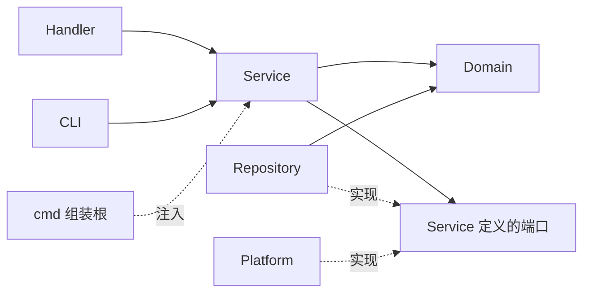

“实现”是接口关系，不是 Service 导入具体实现。`internal/architecture_test.go` 检查真实 import 方向；领域和服务不能依赖文件 I/O、HTTP、JSON 编解码、SQL 或外部框架。`net.JoinHostPort` 等纯地址操作不执行网络访问。

### 按问题找代码

| 问题 | 阅读入口 |
| --- | --- |
| 请求如何进入 | `handler/server.go` 和对应路由文件 |
| 任务字段/默认值/日期和代码约束 | `domain/job.go`、`domain/job_options.go` |
| 创建、取消和选择采集流程 | `service/jobs.go`、`service/tdx_ingestion.go` |
| 可变进度、快照和状态 | `service/job_run.go`；实体定义在 Domain |
| 历史翻页和停止条件 | `service/history.go` |
| 单证券保存及成功断点顺序 | `service/worker.go`；接口在 `service/ports.go` |
| 重启、日志截断和选择性恢复 | `service/recovery.go`、`repository/jobs_jsonl.go`、`repository/archive_state.go` |
| CSV 如何保留旧历史并修正重叠 | `repository/archive_csv.go` |
| 研究查询的约束和返回类型 | `domain/warehouse.go`、`service/warehouse.go` |
| 原生连接、GORM 配置、事务与 DuckDB 方言 | `repository/duckdb.go` |
| 持久化模型、表结构和版本迁移 | `repository/warehouse_schema.go` |
| 行情入库、修订、元数据同步及参考资料导入 | `repository/warehouse_write.go` |
| 研究查询、数据集分页及完整 Parquet 快照 | `repository/warehouse_read.go` |
| 预览为何先计算再截窗 | `service/preview.go`；纯算法在 `domain/adjustment.go` |

`service/models.go` 只保留编排内部的 Domain 类型别名，没有复制一套实体定义。不要在各层重新定义相同业务实体。

### 一次采集的调用过程

1. Handler 解码 `domain.DownloadOptions` 并调用 `JobService.Start`；HTTP 返回后任务继续，关闭页面不取消任务。
2. Domain 统一默认值和业务约束；Service 检查当前环境是否注入所选来源与存储能力。
3. Service 调用归档端口准备输出位置，再通过任务仓库记录起始事件，发布后台任务。
4. 优先尝试完整离线恢复；否则选择本地、历史源或通达信流程。稳定证券/文件计划落盘后才开始逐项处理。
5. 每个通达信 worker 独占连接，读取目标区间全部页面并排序去重；增量维护回看最近 7 个自然日。
6. 原始归档通过校验、合并和临时文件发布；独立因子按来源策略保存，随后可选仓库事务入库。
7. 所需资源完成后再次观察哈希，最后写成功断点，再更新内存统计。
8. 所有 worker 收尾后归纳终态。SSE 只推快照，不拥有任务生命周期。

CSV、sidecar、因子与 DuckDB 不共享分布式事务。数据库失败时保留归档，通过主键幂等重放恢复，保证可重放的至少一次执行，不能称为恰好一次。BaoStock 因子失败使该证券失败；通达信 gbbq 附件写失败目前降级为覆盖警告，策略在对应服务流程中明确说明。

### 预览与研究查询

CSV 预览：Handler 解析输入 → PreviewService 验证逻辑文件名 → PreviewRepository 读完整原价/事件 → Domain 纯复权计算 → Service 返回完整序列或截取窗口 → Handler 序列化。Handler 不读文件，Domain 不做 I/O，Repository 不选择复权方式。

仓库查询：Handler 构造类型化查询 → WarehouseService 调用领域校验和日期归一化 → WarehouseQueries 明确方法 → DuckDB Repository 使用 GORM 构造并执行查询，底层调用官方 DuckDB 原生驱动。结果是类型化模型，Handler/Service 不再持有 `Call(any)` 或 Python `op`。

原始价、单位、来源保留边界、完整性未核验、单写者及研究快照的约定见 [数据约定](#数据约定与边界)。

### 如何验证边界

架构测试直接检查生产 import；领域测试覆盖代码/日期/查询约束；服务测试用端口替身验证读取前校验、全序列复权后截窗、原始价不变。原有真实归档、日志恢复、协议、进程取消、DuckDB 与浏览器回归继续执行。

### 原生 DuckDB 的资源与事务边界

`DuckDB` 按需打开原生连接池、创建 GORM 会话并事务化迁移；只发布完成初始化的连接池。GORM 的显式 Transaction 覆盖整批操作，关闭默认逐条事务及嵌套事务。单物理连接串行化事务访问，等待连接和执行 SQL 均传递 context，取消时回滚，Close 后不再重开。数据库连接与原生资源由组装根关闭。

入库以已归档 CSV 为依据，前后核验 SHA-256。价格和成交额在 Go 中通过十进制有理数精确舍入，按字符串绑定到 Decimal 列，成交量明确从手转为股；整批检查数量、边界和 OHLC 关系后，行情、旧值修订、资料、回执及独立因子在一个事务中提交。回执与文件不一致时拒绝写成功断点。

导出在一个事务中生成八张表和 manifest，数据库提交后才把暂存目录原子发布；失败或取消清理本次暂存目录。Python 仅存在于 BaoStock SDK 适配和可选研究示例，Repository 不导入进程桥接，也不启动解释器。

### ORM 映射与专用 SQL

`warehouse_schema.go` 定义行情、修订、证券资料、日历、供应商因子、回执、除权事件和版本记录的持久化模型，逐字段声明实际列名及复合主键；不增加 `gorm.Model` 的隐式 ID、软删除字段，也不向领域实体添加 ORM 标签。常规查询使用 GORM 的 Table/Where/Group/Scan/Count，写入使用 Create/CreateInBatches 与 OnConflict。

被动证券观察只补充非空资料；人工参考导入可显式清空名称和日期；断点重放不覆盖后来校准的资料。日期为空映射为 SQL NULL，日历的 false 使用明确的冲突更新列写入，避免默认零值省略改变业务含义。因子的 DECIMAL 字段以十进制字符串绑定，查询显式转为文本。

DuckDB 方言只实现 GORM 扩展接口并注册原生 CRUD 回调，不另造 ORM。迁移显式控制版本，使用 GORM Migrator 根据模型创建缺失表和日线视图，不运行 AutoMigrate 修改已有列。新增模型与实际类型、默认值、复合主键由真实数据库契约测试验证。

证券资料的条件更新由 Go 选择更新列，再交给 ORM OnConflict，不手写 CASE/COALESCE 更新表达式；因子以有理数检查 DECIMAL(30,15) 的舍入与范围，普通统计使用 ORM Count。

行情导入使用 Go 流式 CSV 解析、十进制质量校验、旧值比较与 GORM 批量写入，不再依赖 SQL 临时表或大段合并 SQL。仓库读写中仅 Parquet 导出保留固定表名的 `COPY` 专用语句；查询仍包含 COUNT、CAST、连接条件等必要表达式。GORM 负责查询构建与参数绑定，Go 负责明确的质量校验与值比较。

### 仓库文件如何划分

仓库实现收拢为四个文件：`duckdb.go` 管理连接与框架适配，`warehouse_schema.go` 集中模型和结构版本，`warehouse_write.go` 集中写入路径，`warehouse_read.go` 集中查询与快照导出。真实数据库回归集中在 `warehouse_test.go`。

ORM 减少映射和 CRUD 样板，不代替归档核验、单位转换、整批事务、数据修订和快照发布规则。文件按这些职责聚合，不为日历、因子、导入或导出各拆一份实现文件，也不新增 package 或抽象接口。


## 程序设计与交互流程

下图描述当前实现，不表示未来规划。Go 没有传统面向对象语言的继承层次，类图中的“类”对应结构体，“接口”对应消费端端口，虚线空心箭头表示隐式实现；为便于阅读，方法省略部分参数、返回错误和非关键字段。流程图中的错误出口与资源边界同样属于设计的一部分。

### 1. 启动、依赖组装与资源生命周期

入口：`cmd/qflux/main.go`、`cmd/qflux/sync.go`。`cmd` 只组装应用，不承担下载规则；HTTP 和 CLI 复用同一个 `JobService`。仓库按需初始化，创建 `DuckDB` 对象不等于已打开数据库。进程锁在业务运行前获取，避免两个应用进程写同一数据目录。

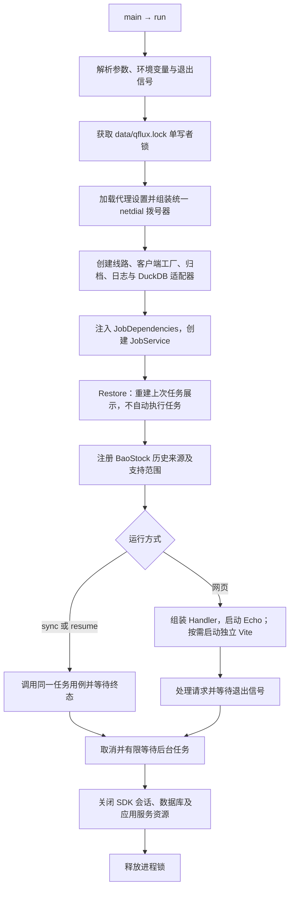

任务上下文独立于发起请求的 HTTP 上下文：关闭网页只断开订阅。预览查询则继承请求上下文，关闭预览可以取消读取。应用退出时先停止任务，再关闭任务依赖的 SDK 和数据库，最后释放锁。

### 2. 核心结构体、接口与实现关系

入口：`internal/service/ports.go`、`jobs.go`、`warehouse.go`、`preview.go`；实现位于 `repository` 和 `platform`。图中的 `BaoStockSource` 对应 `baostock.Source`，`LocalFileSource` 对应 `historyfile.Source`，`TdxClient` 对应 `tdx.Client`。

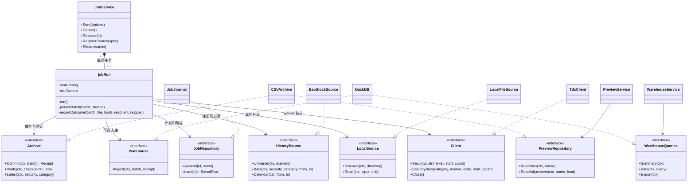

`Archive` 与 `PreviewRepository` 分开，使预览只依赖只读能力；`Warehouse` 与 `WarehouseQueries` 分开，使采集只需要幂等入库能力。`FactorRepository`、`LineProvider` 等辅助端口也由消费端声明，图中省略以控制规模。具体实现由 `cmd` 注入，Service 不反向导入 Repository / Platform。

| 设计原则 | 当前代码中的落点 |
| --- | --- |
| 单一职责 | Handler 处理传输；Service 编排；Domain 定义规则；Repository 存取资源；Platform 适配技术协议 |
| 开闭原则 | 通用历史来源通过 `RegisterSource(SourceSpec)` 接入；本地格式通过 `Source.Readers` 注册解码器。通达信保留独立分页和并发路径 |
| 里氏替换 | 端口实现应满足既定语义：标准未复权行情、明确单位、错误可见；替身和真实适配器共同验证调用约定 |
| 接口隔离 | 采集写入、研究查询、预览读取、因子和参考资料能力分开声明，不要求 CSV-only 流程依赖完整数据库接口 |
| 依赖倒置 | 外部实现依赖消费端契约，组装根负责连接；架构测试限制真实 import 方向 |

### 3. 领域实体如何传递数据和恢复依据

入口：`internal/domain/market.go`、`archive.go`、`job.go`。`Batch` 描述本次处理，`Receipt` 描述合并后的实际文件，`Checkpoint` 描述可供恢复验证的资源，三者的条数和时间范围不能混用。

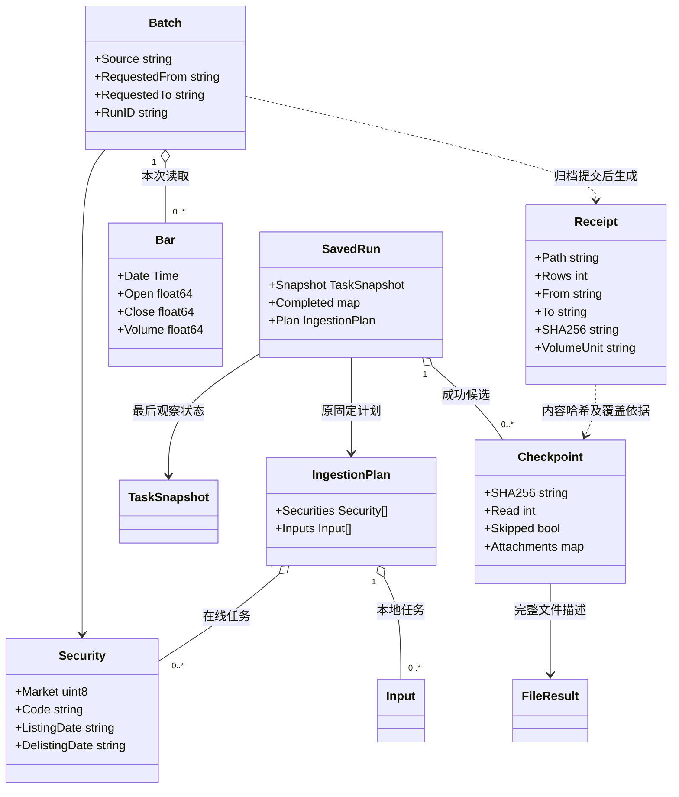

例如，本次增量读取 200 条，与旧文件合并后共有 5,000 条：`Batch.Bars` 是本次取得的记录，`Receipt.Rows` / `FileResult.Bars` 是完整文件量，任务 `Bars` 统计本次成功读取量。恢复复用文件时，本次读取量为 0，不能把旧的 5,000 条算成新增下载。

### 4. 任务状态、SSE 与取消语义

入口：`internal/service/jobs.go`、`job_run.go`、`tdx_ingestion.go`、`recovery.go`；订阅在 `internal/handler/server.go` 和 `frontend/src/hooks/useTask.ts`。

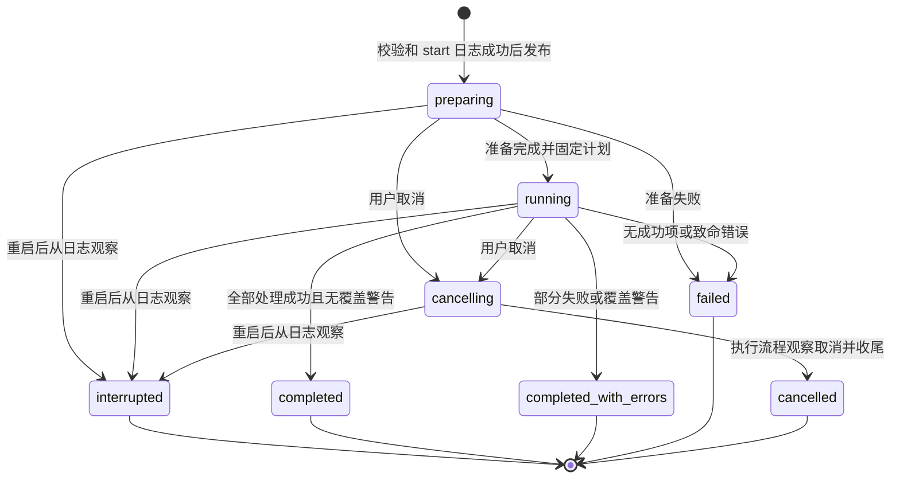

`interrupted` 是日志恢复时的观察状态，旧协程已经不存在；点击恢复会创建新任务编号，并保留旧日志。不同执行路径在准备阶段发现取消时也可能直接结束为 `cancelled`，图中突出通常的显式取消路径。

SSE 建立连接后立即发送快照，再约每 400 ms 发送完整 `TaskSnapshot`。浏览器重连可以重新获取当前状态，无需补齐逐条增量消息。SSE 的连接状态与任务状态相互独立；单活动任务互斥由 `JobService` 管理，SSE 不调度任务。`completed` 说明本次任务完成，不证明来源包含全部历史证券或全部历史行情。

### 5. 多来源调度为什么复用同一条保存流程

入口：`internal/service/tdx_ingestion.go`、`remote.go`、`local.go`、`worker.go`。先检查完整离线恢复，再接触外部来源；稳定计划先持久化，之后才处理证券或文件。

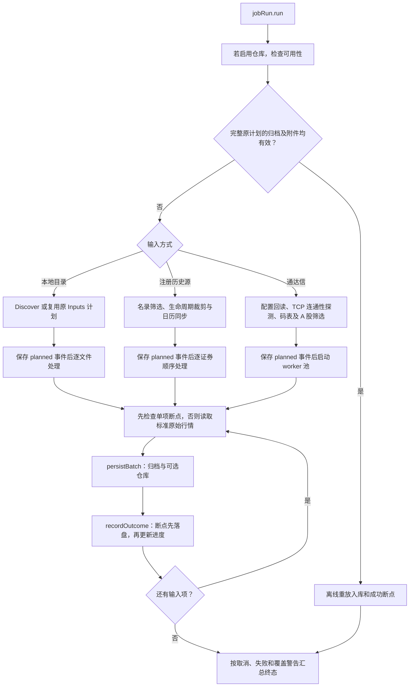

图中省略每项失败出口：单证券/文件失败记为失败项，通常继续后续项；计划、必需参考资料或准备失败可终止整个任务。通达信每个 worker 独占 TCP 客户端，避免同步协议的请求与应答串线；BaoStock SDK 会话顺序使用，不套用 TCP worker 并发。增量模式在用户范围内回看最近 7 个自然日，新值覆盖重叠日期，旧历史继续保留。

### 6. 通达信 800 条分页、日期边界和失败保护

入口：`internal/service/history.go` 的 `fetchBarsWithOptions`。800 是单次请求上限，历史偏移的协议边界是 16 位；不能在转换为 `uint16` 后才检查，也不能把边界误称为已获得完整历史。

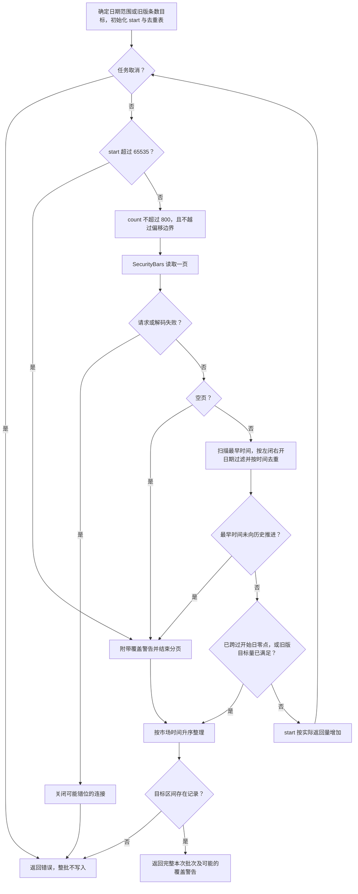

结束日先转换成“次日零点”的排他上界，因此包含结束日全部分钟记录。向前翻到开始日下午仍可能遗漏上午，只有跨过开始日零点才满足开始边界。分页不足 800 条不直接视为耗尽，偏移按实际返回量移动；重复页则停止并提示，避免死循环。任一页发生错误，不会把已取得的部分页面写成完整结果。

### 7. CSV、数据库与成功断点的先后顺序

入口：`internal/service/worker.go` 的 `persistBatch` / `recordOutcome`，以及 `repository/archive_csv.go`、`jobs_jsonl.go`。以下以通达信行情保存为例，`Storage=csv` 时跳过数据库阶段。

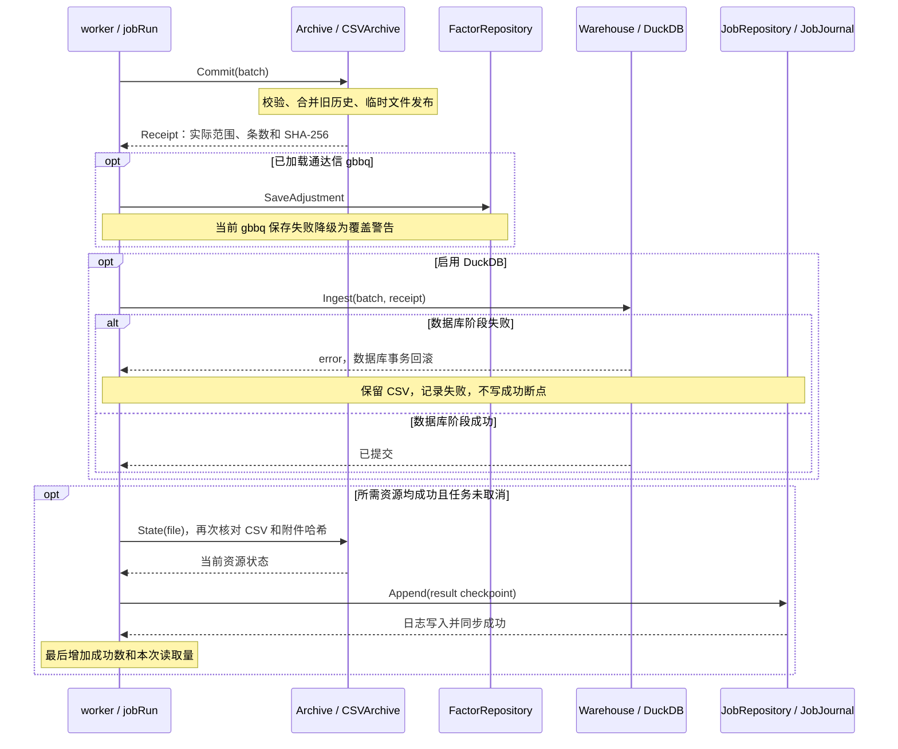

这不是跨文件系统、DuckDB 和 JSONL 的分布式事务。数据库成功但断点失败时，界面仍不能计为本项成功；下次通过幂等入库重新执行。因此保证的是可验证、可重放的至少一次处理，而不是跨资源恰好一次。

BaoStock 有不同的因子策略：请求独立因子后先保存供应商附件，并按仓库能力写因子表，再进入行情 `persistBatch`；因子失败使本证券失败。该因子阶段有独立事务，后续行情失败不回滚它。不能把它与通达信 gbbq 的降级策略或复权语义混为一谈。

### 8. 恢复依赖内容验证，不能只判断文件存在

入口：`internal/service/recovery.go`、`worker.go`，`internal/repository/jobs_jsonl.go`、`archive_state.go`。`Restore` 恢复展示，`Resume` 才创建执行；两者不等价。

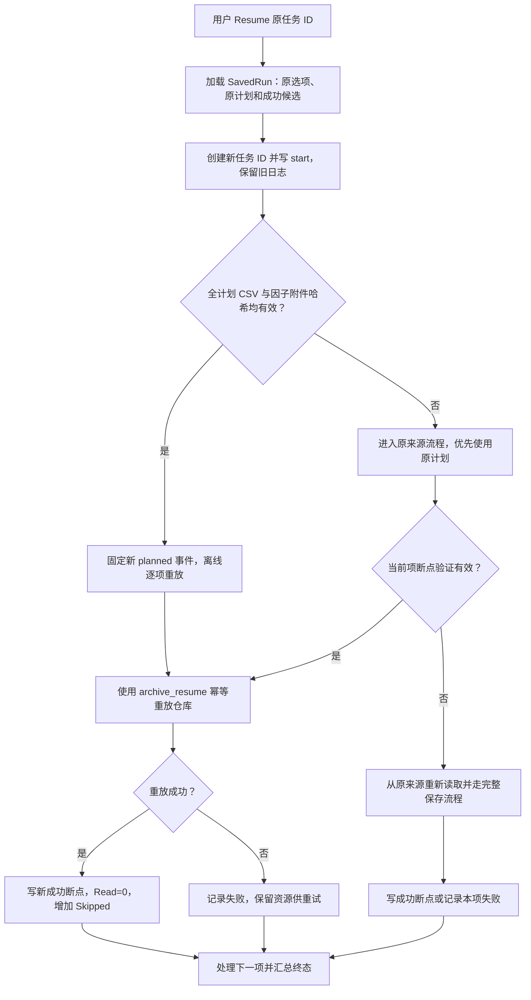

文件存在也可能被改写，必须同时验证内容哈希和当时记录的附件。有效 CSV 不能证明数据库还在，所以恢复仍需重放入库；重放失败不会偷偷转为重新下载来掩盖仓库故障。`archive_resume` 还限制参考资料更新，避免旧计划覆盖后来人工校准的证券资料。

### 9. 原生 DuckDB 的整批事务与修订保存

入口：`internal/repository/warehouse_write.go`，模型和迁移在 `warehouse_schema.go`。以下是 `Ingest` 内部流程，全部数据库动作经 GORM，CSV 的发布已在进入本流程前完成。

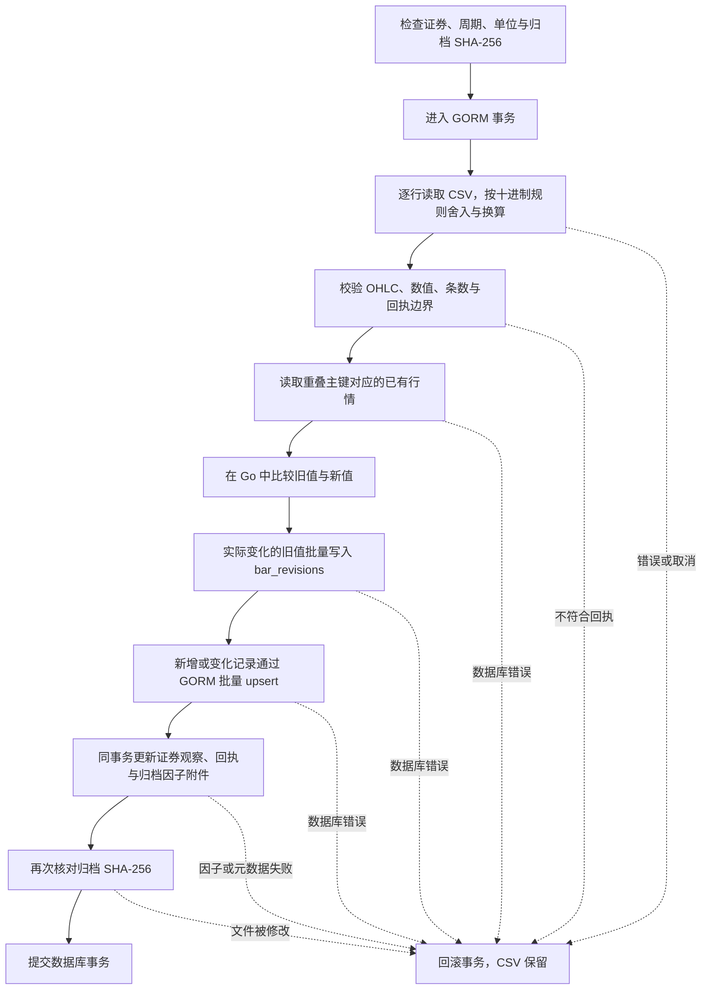

相同主键且数值相同的重放不会再次写行情，也不会制造修订或改写原来源/入库时刻；数值变化才保存旧值并更新当前值。价格和成交额按十进制精确处理，图表的浮点转换不参与这一流程。单物理连接串行化事务访问，等待连接与执行操作均传递上下文；显式版本迁移只创建缺失对象，不通过 AutoMigrate 任意修改已有列。

### 10. 研究表之间是业务关联，不伪造完整历史身份

入口：`internal/repository/warehouse_schema.go`，字段口径见[数据约定与边界](#数据约定与边界)。图中的连线表示逻辑查询关联，不表示已声明数据库外键；名录和日历可以缺失，代码相同也不能自动证明跨历史阶段属于同一家公司。

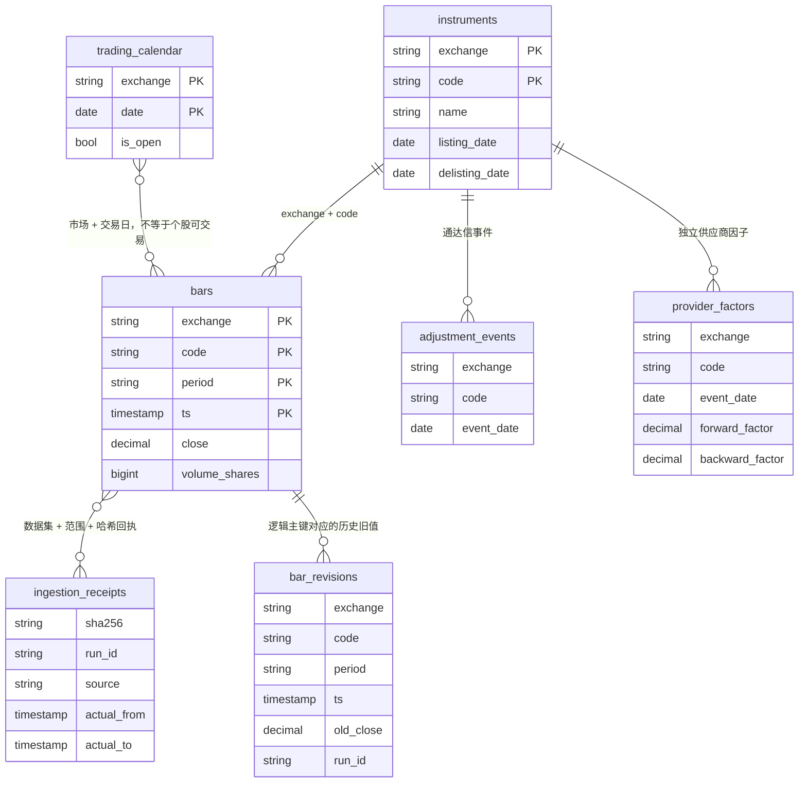

`schema_migrations` 独立记录结构版本，不是业务事件表；`daily_bars` 是 `bars` 的日线视图，不重复保存行情。图中省略审计时间及部分业务字段。证券资料、日历和供应商因子也有独立同步入口，其事务不与整个市场的采集任务绑定；某只行情失败不会回滚之前已同步的参考资料。

### 11. 完整历史预览、日期筛选和框选如何协同

入口：`internal/service/preview.go`、`repository/preview.go`、`repository/warehouse_read.go`，前端在 `PricePreview.tsx`、`lib/api.ts`、`lib/preview.ts`。

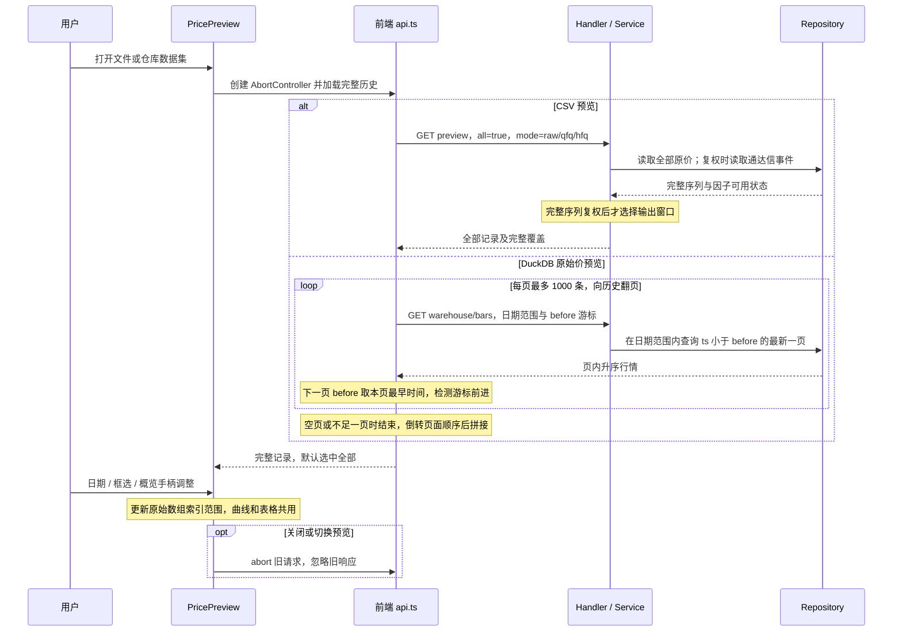

两条路径的复权能力不同：CSV 可用通达信事件做实时前/后复权，仓库预览当前只显示原始价；供应商比例因子独立保存，不在这里混合解释。CSV 全量读取不再受原先 64 MB 预览阈值限制，采用逐行转换减少额外字符串内存；仍需内存容纳完整序列。仓库通过有限页请求加载全部记录，多个页面并非同一个数据库事务快照；需要研究一致性时使用 Parquet 快照。

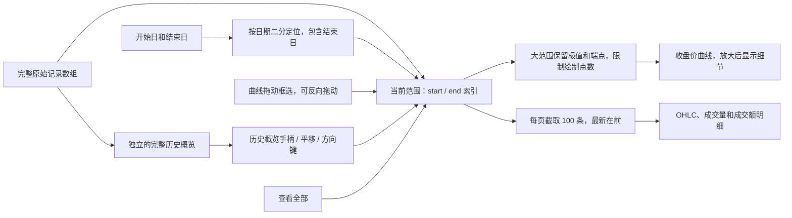

采样只影响曲线绘制，不删除完整数组中的记录；明细翻页可查看每条原始记录。日期范围没有数据时显示错误并保留原选区，改范围会回到明细第一页。复权以完整历史计算，日期调整和缩放只改变可视窗口，不能改变后复权基准。

### 12. 一致性 Parquet 快照的生成和发布

入口：`internal/repository/warehouse_read.go` 的 `Export`。`daily_bars` 是视图，不单独导出；八张基础表和 manifest 一起构成研究快照。

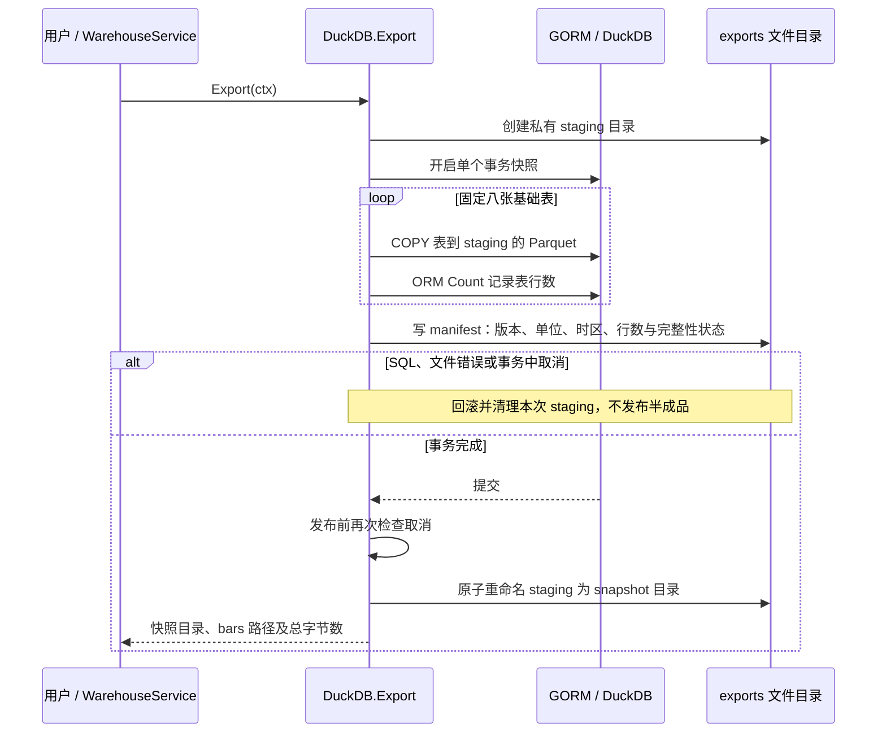

这里的一致性指同一数据库事务中读取各表，不表示来源历史已经完整核验。应用运行时，其他研究进程优先读取发布后的快照；直接打开 DuckDB 文件进行研究，应在应用停止后以只读方式使用。

### 13. 统一代理与 SDK 会话更新

入口：`cmd/qflux/main.go` 的热应用包装、`service/settings.go`、`repository/settings.go`、`platform/netdial/dialer.go`。代理不是各客户端分别维护的配置。

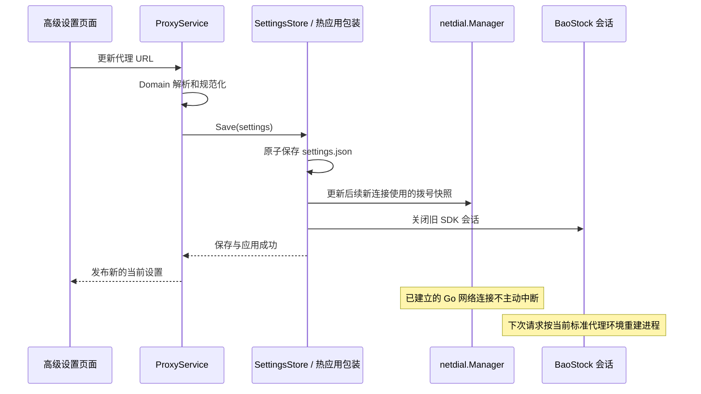

网页保存的配置优先于环境初始值；命令行 `--proxy` 可在启动时显式更新。通达信和线路探测注入同一 `DialContext`，出站 HTTP 使用同一管理器的 `HTTPTransport`；Python SDK 只接收统一生成的标准代理环境变量。这样避免“界面显示一个代理，但部分请求仍绕过它”的配置分叉。

## 数据约定与边界

### 时间、价格与单位

| 层 | 价格 | 成交量 | 成交额 | 时间 |
| --- | --- | --- | --- | --- |
| 标准 CSV | 未复权元 | 手，1 手 = 100 股，可含小数 | 元 | 北京时间；日线为日期，分钟线含时分 |
| DuckDB / Parquet | `DECIMAL(18,6)` 未复权元 | `BIGINT volume_shares` 股 | `DECIMAL(24,4) amount_cny` 元 | `ts TIMESTAMP` 表示北京时间，不随宿主时区变化 |
| 采集与审计时刻 | — | — | — | `TIMESTAMPTZ`，按 UTC 保存 |

通达信网络股票 K 线使用手；本地股票 `.day/.lc1/.lc5` 使用股；BaoStock 的 `volume` 使用股。适配器先转到标准归档单位，入库时统一为股。外部 CSV 补录必须明确选择单位，系统不会猜测。

协议和本地二进制的量额精度受上游编码限制，Decimal 不会恢复源数据已经丢失的精度。原始行情不通过零填充或插值制造缺失记录。

### 表

- `bars`：主键 `(exchange, code, period, ts)`；原始 OHLC、股数、成交额、采集来源、入库时刻。
- `daily_bars`：日线研究视图，包含 `trade_date`。
- `instruments`：名称、上市/退市日期、状态、参考来源、首次与最近观察时刻。来源未提供的日期保持 NULL。
- `trading_calendar`：市场、日期、开市标记及参考来源。
- `adjustment_events`：通达信 gbbq 事件，不与其他供应商的比例因子混用。
- `provider_factors`：BaoStock 原始前/后复权和事件因子，独立于价格，保存来源与获取/入库时刻。
- `ingestion_receipts`：文件哈希、请求及实际范围、警告、来源和任务编号。
- `bar_revisions`：被新值替换的旧行情及替换时刻、来源和任务编号。
- `schema_migrations`：数据库结构版本。

行情预览支持完整序列、日期范围与框选缩放，明细分页显示全部记录。批量研究请读取 DuckDB 或一致性 Parquet 快照。

### 来源与支持范围

| 来源 | 适用场景 | 重要边界 |
| --- | --- | --- |
| 通达信在线 | 沪深北当前码表，日线和分钟线，含 1 分钟 | 单次最多 800 条；可分页但历史保留有限；当前码表不是历史全体证券 |
| BaoStock 官方 SDK | 沪深历史证券名录、来源提供的退市证券、日历、日/周/月及 5/15/30/60 分钟 | 当前适配器不提供北交所或 1 分钟；公网服务可能断连；来源可得不等于完整已证实 |
| 本地历史文件 | `.day/.lc1/.lc5` 或规范 CSV | 只证明文件包含的记录；来源、覆盖和单位仍需确认 |

退市样本以源提供的证券名录为准。仅按“目前上市”过滤会产生幸存者偏差。历史代码更名、代码复用、北交所旧码到 920 的公司身份映射，需要额外可信参考数据；不要仅凭相似代码自动拼成同一家公司。

### A 股代码筛选口径

`internal/domain/universe.go` 的 `IsAShare` 使用按市场划分的闭区间规则，只接受六位 ASCII 数字。规则和匹配流程分开维护，不从名称、ST 或当前退市状态决定是否保留历史行情。

| 市场 | 普通股候选号段 | 明确排除 |
| --- | --- | --- |
| 深圳 | `000001–001000`、`001200–004999`、`300000–309799` | `001001–001199` 主板存托凭证、`309800–309999` 创业板存托凭证，以及指数、基金、B 股等 |
| 上海 | `600000–601999`、`603000–603999`、`605000–605999`、`688000–688999` | `689` 存托凭证、申购码、基金、B 股及其他号段 |
| 北京 | 历史 `43`、`83`、`87`、`880000–888999`，以及 `920000–920999` | `889` 发行申购码、`820` 优先股、`899` 指数等 |

深圳区间依据[深交所主板代码安排](https://www.szse.cn/www/marketServices/technicalservice/notice/t20210205_584702.html)和[证券代码区间表](https://www.szse.cn/marketServices/technicalservice/doc/P020241212550140892927.pdf)。例如 `302132` 属于创业板普通股，不应仅因前缀不是 `300` 或 `301` 被排除。

这是代码号段分类，不能证明某个代码已实际发行或曾在北交所上市。北交所旧码与股转系统存在重叠，具体上市范围须以来源名录或可信历史参考资料确认；[北交所新旧代码对照表](https://www.bse.cn/service/code_mapping.html)提供迁移参考，分类器不自动拼接公司身份。未知市场和不规范代码直接拒绝，输入前缀处理仍由 `ParseCodes` 负责。

### 质量和完整性的区别

通过 OHLC、数值、主键和时间校验，只说明已存记录满足基本质量约束。

“完整历史”还需要核验历史证券全体、上市/退市边界、完整交易日历、停复牌记录，以及供应商自身保留和修订情况。因此本版本整体完整性保持 `unverified`。

候选缺口检查依赖已导入的上市日期和交易日历。某个开市日没有 K 线也可能是停牌，不应自动补零或当作系统丢数。没有参考资料时查不到缺口，不代表完整。

增量模式回看 7 个自然日，覆盖近期常见修订；更早的修订和历史空洞需要定期运行“历史建库”重新扫描对应范围。增量更新不会自动证明过去没有缺失。

本系统记录“本次什么时候观察/导入了数据”，不等同于完整历史 point-in-time 数据库。当前名称、ST 状态、财务公告、成分股、流通股本和公司身份变迁的历史快照，不由现有行情表推断。因子也不能作为当时已经公开的事件时间来使用。

### 补录 CSV

```csv
date,open,high,low,close,volume,amount
2024-01-02,10,11,9,10.5,100,105000
```

文件名例如 `sh600000_day.csv`、`sz000001_5m.csv`、`bj920001_1m.csv`。UTF-8/UTF-8 BOM 均支持；分钟时间格式为 `YYYY-MM-DD HH:MM`。目录可递归扫描，符号链接和非匹配文件跳过。

证券参考模板为 `exchange,code,name,listing_date,delisting_date,status`，交易日历模板为 `exchange,date,is_open`。参考导入必须填写来源，单批失败整批回滚。页面可以下载模板。

### 研究快照与备份

Parquet 导出包含全部研究与审计表，附带 `manifest.json`，记录 schema、时间、单位和行数。所有表在同一数据库事务中导出，临时目录完成后再发布。

DuckDB 文件是单进程写入模型。应用运行时，用导出快照进行多进程研究；关闭应用后可以直接只读打开数据库。备份建议包含 `data/` 与归档目录；不要只保存 `bars.parquet` 而遗漏名录、因子、修订和任务日志。

### 一手资料

- [BaoStock 官方基本资料接口](https://www.baostock.com/mainContent?file=stockBasic.md) 与 [官方 SDK 发行](https://pypi.org/project/baostock/)。
- [pytdx 的 K 线参数](https://rainx.gitbooks.io/pytdx/content/pytdx_hq.html)、[日线读取实现](https://github.com/rainx/pytdx/blob/master/pytdx/reader/daily_bar_reader.py)、[分钟线读取实现](https://github.com/rainx/pytdx/blob/master/pytdx/reader/lc_min_bar_reader.py)。
- [DuckDB 并发模型](https://duckdb.org/docs/stable/connect/concurrency)。

下载数据的授权范围以相应来源为准；本仓库只提交程序与测试，不分发采集数据。


### 为什么 1 分钟选择三年却只能得到几个月？

`SecurityBars` 请求中的 `start` 是相对最新 K 线的根数偏移，使用 16 位无符号字段（`client.go` 的 `payload[12:14]`），最大为 65,535。程序每页最多请求 800 条并按实际返回量继续翻页，因此 800 不是总量限制。按每天 240 根估算，65,536 根也只相当于约 273 个交易日；行情服务器还可能在此之前返回空页。把日期拆成多段、提高并发或扩大 Go 整数都不会扩展服务端历史。

下载结果遇到空页、重复页或偏移边界时会保留已取得的原始数据，同时列出请求日期、本轮源端实际可见日期、目标区间取得条数和停止原因，标记为需要检查覆盖；完全没有交集时明确报错并保留原文件。该报告不声称仅凭首尾时间已证明中间每一分钟连续。

要补齐三年真实的 1 分钟 OHLCV，需要提供含该范围的 `.lc1` / 分钟 CSV，或接入具备相应历史能力的数据源；当前 BaoStock 适配器没有 1 分钟能力，分时价格也不能代替完整的分钟 OHLCV。已有本地补录会按时间合并并可入库 DuckDB，不受在线偏移限制。增量维护只有在已存最早日期不晚于请求起点时才缩短为七天回看；仅存最近几个月的文件不会让早期请求被静默跳过。内部缺口和历史修订仍应使用历史建库模式全范围扫描。


### 实时看盘

运行 `npm run dev`，打开 `http://127.0.0.1:7100`，进入顶部「实时看盘」。默认自选为招商银行、贵州茅台、平安银行、宁德时代；实际名称从本地已存证券名录补充，未收录显示「名称待补充」。添加六位代码或 `sh` / `sz` / `bj` 前缀，最多 20 只，点击列表切换当前主屏。自选、选中项与刷新间隔只保存在浏览器 `qflux.realtime` 中，不写数据库行情表。

主屏提供价、涨幅、昨收、开高低、量额、五档盘口、扩展成交明细及其窗口走势。价格为元，快照与成交数量沿用参考协议的手，成交额为元（页面按万元展示）。走势只有本轮最近至多 200 条扩展成交，不表示全天分时；源端时间没有日期，不伪造交易日。显示的更新时间是本机快照接收时间，休市返回的可能是上个交易日行情。

**当前完整交易所 L2 未接入。** `original/tdx_realtime.py` 的 `0x053E` 提供 L1 五档；`0x0FC2` 提供带秒、通常约三秒聚合的成交明细，没有十档、逐笔委托序号或可验证的 L2 授权。参考模块将非空回包称作 L2 的推断未沿用，API 的 `l2Verified` 为 false；明细可以是 `available` / `empty` / `unavailable`，故障不会屏蔽有效快照。完整 L2 需以后接入授权供应商真实接口，而非把五档改名为十档。

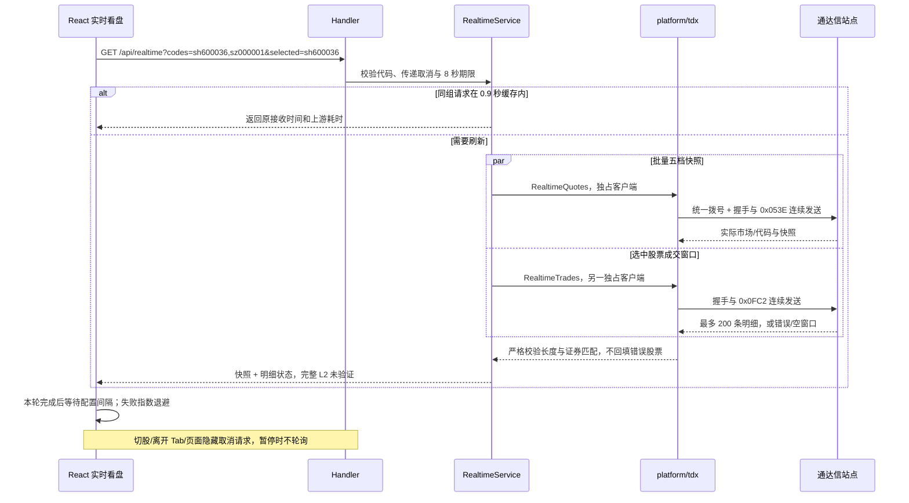

实现复用地图：`internal/platform/tdx/realtime.go` 移植参考采集器的 `SNAP_FIELDS`、`parse_snapshot`、`parse_order` 及握手流水线；解压、变长数、写完整帧复用现有 Go 协议工具。`internal/service/realtime.go` 承接 `tdx_dash.py` 的短缓存与快照/明细分离，限制一轮刷新（内部两条连接），缓存至多 32 组；名称由 `internal/repository/realtime.go` 经 GORM 读取已有名录。`internal/handler/realtime.go` 只负责参数及响应。`RealtimeBoard.tsx` 对应参考 `dash.html` 的主屏，`useRealtime.ts` 管理无重叠刷新、失败退避、10 秒客户端超时与取消。所有连接共用应用代理和请求预算，不启动额外 Python 服务，也不恢复参考脚本的业务健康探测。

默认刷新间隔 3 秒，可选 2 / 3 / 5 / 10 / 30 秒，含义为上一轮完成后等待的间隔。失败延长至最多 30 秒；无扩展明细时显示五档降级，整轮快照失败时保留旧数据并标记过期。报价为 0 时显示缺失，不把除零结果当涨幅。P2 的终端查看可继续使用原脚本；本轮不新增桌面组件。

验证：`npm test`、`node scripts/go.mjs vet ./...`、`npm run frontend:lint`、`npm run frontend:build`；构建后运行 `python scripts/smoke_preview.py`。`internal/platform/tdx/testdata/realtime.json` 的期望值由原 Python 解码器生成；协议测试检查二进制对照、截断与错配拒绝、握手无等待流水线。浏览器测试仅在测试窗口注入样例，覆盖 Tab、多股票、快速切换、暂停/恢复、离开后停止请求、明细降级、失败旧数据提示及手机无溢出；生产路径没有模拟数据开关。

手工验收：添加并切换一只 A 股，核对代码与主屏一致；观察两个刷新周期及列表涨幅；切换间隔、暂停并检查网络面板停止请求；离开 Tab 后确认没有继续请求；断开代理观察旧数据过期提示，恢复代理后确认自动更新；明细不可用时确认五档仍显示，且始终明确完整 L2 未接入。真实站点结果受休市、线路能力及权限影响，不能用接收成功证明交易所实时性。


### 高密度自选表格与可选原生小组件

自选监控采用全宽紧凑表格：桌面每行约 32px、手机约 36px。表头固定，价格、涨幅、涨跌额、量额可排序，支持按名称/代码筛选及定位当前股票。名称和代码在宽屏同一行；窄屏收起低频列，仍保留股票、最新价、涨幅和本机接收时间，状态用小色点表示。悬浮行可查看完整数值、开高低、昨收及状态。换手率显示 `—`：现有协议没有流通股本分母，不能按成交量猜算。排序和筛选不改变行情订阅，也不额外请求数据。

点击自选区「轻量窗口」可直接运行独立网页小组件，或访问 `http://127.0.0.1:7100/?widget=1`。弹窗复用当前自选，显示名称/代码、价、幅和接收时间；设置中可修改代码、间隔及背景不透明度。默认间隔为主屏的至少两倍且不低于 10 秒，选项为 10/15/30/60 秒，隐藏页面或暂停时停止轮询。普通浏览器窗口无法真正透明到桌面或保证置顶，页面会标注网页模式；系统窗口边框可用于拖动、关闭。

真正的原生壳位于 `desktop/widget`，采用 **Tauri 2 + 系统 WebView**，不使用 Electron，不捆绑 Chromium。Windows 使用 WebView2，macOS 使用 WKWebView。主 Tab 的 `npm run dev`、构建和 Go 后端均不依赖此目录。原生壳配置无边框透明窗口、默认置顶和可调整尺寸，标题区可拖动，按钮可取消置顶、最小化、关闭；最小化/隐藏时取消报价并停止网络轮询。macOS 透明窗口行为与系统/Tauri 版本相关；当前配置启用相应兼容选项，App Store 发布前需按所用版本审核透明窗口 API 和签名要求，不默认承诺商店可分发。

原生壳运行前需安装 Rust stable 工具链及平台前置条件：Windows 的 MSVC C++ Build Tools 和 WebView2；macOS 的 Xcode Command Line Tools。详见 [Tauri 前置条件](https://v2.tauri.app/start/prerequisites/)。先在 `src` 启动 `npm run dev` 或 API，再另开终端执行：

```bash
# 独立安装，不会修改主工程 package.json
npm --prefix desktop/widget ci
npm --prefix desktop/widget run info
npm --prefix desktop/widget run dev

# 在对应操作系统上生成原生发行包
npm --prefix desktop/widget run build
```

配置默认连接本机 `127.0.0.1:7101/api`，可用环境变量 `QFLUX_WIDGET_API_PORT` 改端口。安装包不包含 Go 后端，需先启动它。Rust 原生桥仅允许固定的报价/自选读取端点，不提供通用 URL 请求、文件系统或 Shell 能力；实际行情连接仍由 Go 统一代理/限流。`GET /api/realtime?...&details=false` 不发起成交明细；`POST /api/realtime/watch` 发布主屏自选，`GET /api/realtime/watch` 供原生壳启动时读取，配置仅保存在当前 Go 进程内。原生壳配置中可手动同步主面板，或独立修改自己的监控股票。

新增/调整文件角色：

```text
frontend/src/components/
├── WatchlistTable.tsx        # 固定表头、排序/筛选、对齐数字列及响应式自选表
├── RealtimeBoard.tsx         # 全宽表格接入、发布自选和打开轻量窗口
└── QuoteWidget.tsx           # 网页/原生壳共用的轻量页面及窗口操作
frontend/src/lib/widget.ts   # 最小 Tauri 桥接、请求取消和小组件默认刷新策略
frontend/src/main.tsx        # 根据 widget 参数动态加载，避免小组件载入主屏图表
frontend/src/hooks/useRealtime.ts # 共用生命周期；轻量模式只取快照，pagehide 清理
internal/service/realtime.go # 轻量报价分支、自选配置副本、缓存隔离
internal/handler/realtime.go # details 参数、自选 GET/POST 与校验
internal/domain/realtime.go  # 共享自选配置实体及字段语义
scripts/browser_smoke.mjs    # 20只股票、密度、排序、表头、手机关键列及小组件验收

desktop/widget/
├── package.json             # 仅此模块需要的 Tauri CLI 与启动/构建命令
├── package-lock.json        # 独立工具依赖锁定
├── app-icon.svg             # 小组件图标的矢量源
└── src-tauri/
    ├── Cargo.toml           # 独立 Rust 桌面壳依赖
    ├── build.rs             # Tauri 原生资源构建入口
    ├── tauri.conf.json      # 系统窗口、透明度基础、置顶、资源路径与 CSP
    ├── capabilities/main.json # 最小原生窗口操作权限
    ├── icons/               # Windows/macOS 发行所需图标
    └── src/main.rs          # 固定本机 API 桥及可取消的单路请求
```

验证边界：前后端构建、Go 用例/接口测试和浏览器中的轻量页面可在当前 Windows 环境验证。当前机器未安装 Rust/Cargo，因而尚未编译/运行 Tauri 原生壳；macOS 原生透明、拖动、置顶与签名还需在 Mac 上验收。网页降级入口可独立使用，不依赖这一步，也不把网页截图当成原生透明窗口验收。


实时交互补充：`frontend/src/components/OrderBookRow.tsx` 按股票建立固定基准，使用单调压缩刻度映射条长，避免每轮最大档归一化把实际增减抵消。数量条用 750ms transform 过渡连续伸缩；不再用数字跳动或增减角标代替。盘口的「条形动效」默认开启，显式开关优先于全局减少动态效果规则，也可单独关闭；不会修改系统设置。准确数量以右侧数字为准，切股重置基准，不推断净买入或撤单。`useRealtime` 切股保留同代码旧快照与原接收时间，只清空前一股票成交窗口；已知名称按市场+代码保留，不被临时空名称回包覆盖。`npm run test:realtime` 验证元数据保留、市场隔离和成交窗口清空；浏览器冒烟直接测量数量条开始、中间、结束的像素宽度，覆盖买一变长、最大卖档变短以及其他档位不误动。
