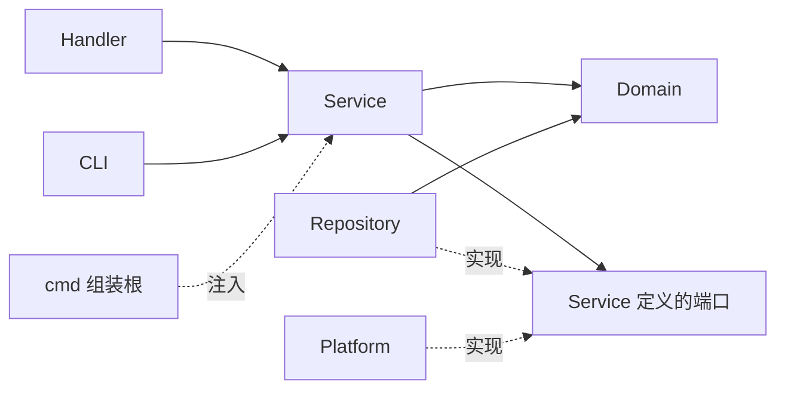

# 后端结构与阅读入口

`internal` 是 Go 的导入可见性边界，不是业务层。本项目在其中按职责集中为四个业务包和一个技术适配目录，不为每个用例新建包。

```text
cmd/qflux/             命令行、依赖组装、启动和退出
internal/
  handler/             HTTP 解析、响应、状态码、SSE
  service/             下载、恢复、预览、研究查询和消费端口
  domain/              领域实体、输入约束、日期规则、纯复权算法
  repository/          CSV、因子附件、JSONL 日志、DuckDB 读写
  platform/            外部技术适配器
    tdx/               TCP 协议和报文解码
    baostock/          官方 SDK 会话
    historyfile/       本地文件输入解码
    lines/ + sitecfg/  线路自检及配置生成
    bridge/            仅 BaoStock SDK 的 Python 工作进程桥接
    filesys/           本机目录浏览
    frontend/          Vite 生命周期
    processlock/       跨进程单写者锁
```

Platform 子包对应独立协议、SDK 或系统能力，不是业务用例。普通业务操作进入已有 Service；同一职责下用文件组织代码。

## 职责和依赖方向

| 层 | 负责 | 不负责 | 项目依赖 |
| --- | --- | --- | --- |
| Handler | URL/JSON 解析、响应序列化、HTTP 状态、SSE | 读行情文件、复权流程、SQL、Python op | Service、Domain |
| Service | 用例编排、协调来源和仓库、任务生命周期、成功断点时机 | HTTP、JSON 编解码、具体文件/数据库读写 | Domain，外部能力通过接口注入 |
| Domain | 实体、约束、范围和单位规则、纯计算 | 文件、SDK、HTTP、数据库和进程 | 标准库纯计算能力 |
| Repository | 文件合并、哈希、任务日志重放、数据库查询与事务 | 证券采集范围、任务成败、HTTP 状态 | Domain、原生数据库驱动 |
| Platform | 协议、SDK、系统及进程适配 | 跨资源业务编排 | Domain、消费端口、必要输入存储工具 |

消费端口在 Service 定义：`Archive`、`JobRepository`、`FactorRepository`、`HistorySource`、`WarehouseQueries`。`cmd/qflux/main.go` 构造并注入具体实现。Service 不导入 Repository/Platform。



“实现”是接口关系，不是 Service 导入具体实现。`internal/architecture_test.go` 检查真实 import 方向；领域和服务不能依赖文件 I/O、HTTP、JSON 编解码、SQL 或外部框架。`net.JoinHostPort` 等纯地址操作不执行网络访问。

## 按问题找代码

| 问题 | 阅读入口 |
| --- | --- |
| 请求如何进入 | `handler/server.go` 和对应路由文件 |
| 任务字段/默认值/日期和代码约束 | `domain/job.go`、`domain/job_options.go` |
| 创建、取消和选择采集流程 | `service/jobs.go`、`service/tdx_ingestion.go` |
| 可变进度、快照和状态 | `service/job_run.go`；实体定义在 Domain |
| 历史翻页和停止条件 | `service/history.go` |
| 单证券保存及成功断点顺序 | `service/worker.go`；接口在 `service/ports.go` |
| 重启、日志截断和选择性恢复 | `service/recovery.go`、`repository/jobs_jsonl.go`、`repository/archive_state.go` |
| CSV 如何保留旧历史并修正重叠 | `repository/archive_csv.go` |
| 研究查询的约束和返回类型 | `domain/warehouse.go`、`service/warehouse.go` |
| 原生连接、GORM 配置、事务与 DuckDB 方言 | `repository/duckdb.go` |
| 持久化模型、表结构和版本迁移 | `repository/warehouse_schema.go` |
| 行情入库、修订、元数据同步及参考资料导入 | `repository/warehouse_write.go` |
| 研究查询、数据集分页及完整 Parquet 快照 | `repository/warehouse_read.go` |
| 预览为何先计算再截窗 | `service/preview.go`；纯算法在 `domain/adjustment.go` |

`service/models.go` 只保留编排内部的 Domain 类型别名，没有复制一套实体定义。不要在各层重新定义相同业务实体。

## 一次采集的调用过程

1. Handler 解码 `domain.DownloadOptions` 并调用 `JobService.Start`；HTTP 返回后任务继续，关闭页面不取消任务。
2. Domain 统一默认值和业务约束；Service 检查当前环境是否注入所选来源与存储能力。
3. Service 调用归档端口准备输出位置，再通过任务仓库记录起始事件，发布后台任务。
4. 优先尝试完整离线恢复；否则选择本地、历史源或通达信流程。稳定证券/文件计划落盘后才开始逐项处理。
5. 每个通达信 worker 独占连接，读取目标区间全部页面并排序去重；增量维护回看最近 7 个自然日。
6. 原始归档通过校验、合并和临时文件发布；独立因子按来源策略保存，随后可选仓库事务入库。
7. 所需资源完成后再次观察哈希，最后写成功断点，再更新内存统计。
8. 所有 worker 收尾后归纳终态。SSE 只推快照，不拥有任务生命周期。

CSV、sidecar、因子与 DuckDB 不共享分布式事务。数据库失败时保留归档，通过主键幂等重放恢复，保证可重放的至少一次执行，不能称为恰好一次。BaoStock 因子失败使该证券失败；通达信 gbbq 附件写失败目前降级为覆盖警告，策略在对应服务流程中明确说明。

## 预览与研究查询

CSV 预览：Handler 解析输入 → PreviewService 验证逻辑文件名 → PreviewRepository 读完整原价/事件 → Domain 纯复权计算 → Service 截末尾窗口 → Handler 序列化。Handler 不读文件，Domain 不做 I/O，Repository 不选择复权方式。

仓库查询：Handler 构造类型化查询 → WarehouseService 调用领域校验和日期归一化 → WarehouseQueries 明确方法 → DuckDB Repository 使用 GORM 构造并执行查询，底层调用官方 DuckDB 原生驱动。结果是类型化模型，Handler/Service 不再持有 `Call(any)` 或 Python `op`。

原始价、单位、来源保留边界、完整性未核验、单写者及研究快照的约定见 [数据约定](data-contract.md)。

## 如何验证边界

架构测试直接检查生产 import；领域测试覆盖代码/日期/查询约束；服务测试用端口替身验证读取前校验、全序列复权后截窗、原始价不变。原有真实归档、日志恢复、协议、进程取消、DuckDB 与浏览器回归继续执行。

## 原生 DuckDB 的资源与事务边界

`DuckDB` 按需打开原生连接池、创建 GORM 会话并事务化迁移；只发布完成初始化的连接池。GORM 的显式 Transaction 覆盖整批操作，关闭默认逐条事务及嵌套事务。单物理连接保证临时入库表不被并发请求覆盖，等待连接和执行 SQL 均传递 context，取消时回滚，Close 后不再重开。数据库连接与原生资源由组装根关闭。

入库以已归档 CSV 为依据，前后核验 SHA-256。价格和成交额从文本直接转换为 Decimal，成交量明确从手转为股；整批检查数量、边界和 OHLC 关系后，行情、旧值修订、资料、回执及独立因子在一个事务中提交。回执与文件不一致时拒绝写成功断点。

导出在一个事务中生成八张表和 manifest，数据库提交后才把暂存目录原子发布；失败或取消清理本次暂存目录。Python 仅存在于 BaoStock SDK 适配和可选研究示例，Repository 不导入进程桥接，也不启动解释器。

## ORM 映射与专用 SQL

`warehouse_schema.go` 定义行情、修订、证券资料、日历、供应商因子、回执、除权事件和版本记录的持久化模型，逐字段声明实际列名及复合主键；不增加 `gorm.Model` 的隐式 ID、软删除字段，也不向领域实体添加 ORM 标签。常规查询使用 GORM 的 Table/Where/Group/Scan/Count，写入使用 Create/CreateInBatches 与 OnConflict。

被动证券观察只补充非空资料；人工参考导入可显式清空名称和日期；断点重放不覆盖后来校准的资料。日期为空映射为 SQL NULL，日历的 false 使用明确的冲突更新列写入，避免默认零值省略改变业务含义。因子的 DECIMAL 字段以十进制字符串绑定，查询显式转为文本。

DuckDB 方言只实现 GORM 扩展接口并注册原生 CRUD 回调，不另造 ORM。迁移显式控制版本，使用 GORM Migrator 根据模型创建缺失表和日线视图，不运行 AutoMigrate 修改已有列。新增模型与实际类型、默认值、复合主键由真实数据库契约测试验证。

证券资料的条件更新由 Go 选择更新列，再交给 ORM OnConflict，不手写 CASE/COALESCE 更新表达式；因子以有理数检查 DECIMAL(30,15) 的舍入与范围，普通统计使用 ORM Count。

仓库读写仍保留五处 Exec/Raw 专用语句：CSV 批量读取到暂存表、整批质量检查、旧值修订集合插入、行情集合 upsert、Parquet COPY。它们与模型写入共用一个事务和连接，避免逐条处理海量行情。聚合查询中的 COUNT、CAST、窗口函数和连接条件仍是 SQL 表达式，ORM 不替代数据库的分析能力。

## 仓库文件如何划分

仓库实现收拢为四个文件：`duckdb.go` 管理连接与框架适配，`warehouse_schema.go` 集中模型和结构版本，`warehouse_write.go` 集中写入路径，`warehouse_read.go` 集中查询与快照导出。真实数据库回归集中在 `warehouse_test.go`。

ORM 减少映射和 CRUD 样板，不代替归档核验、单位转换、整批事务、数据修订和快照发布规则。文件按这些职责聚合，不为日历、因子、导入或导出各拆一份实现文件，也不新增 package 或抽象接口。
